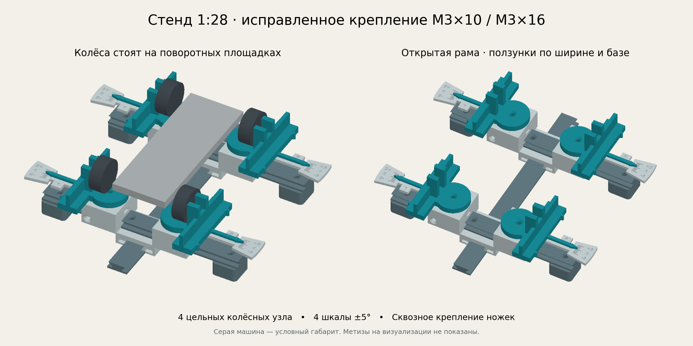
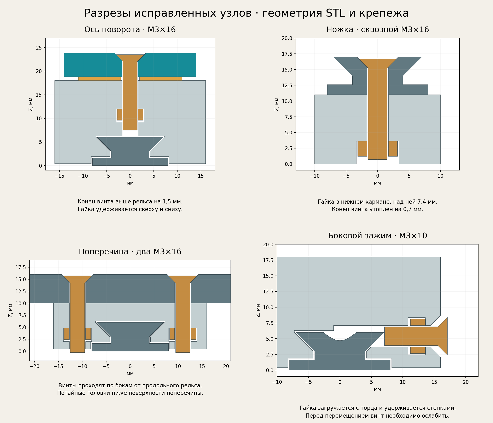
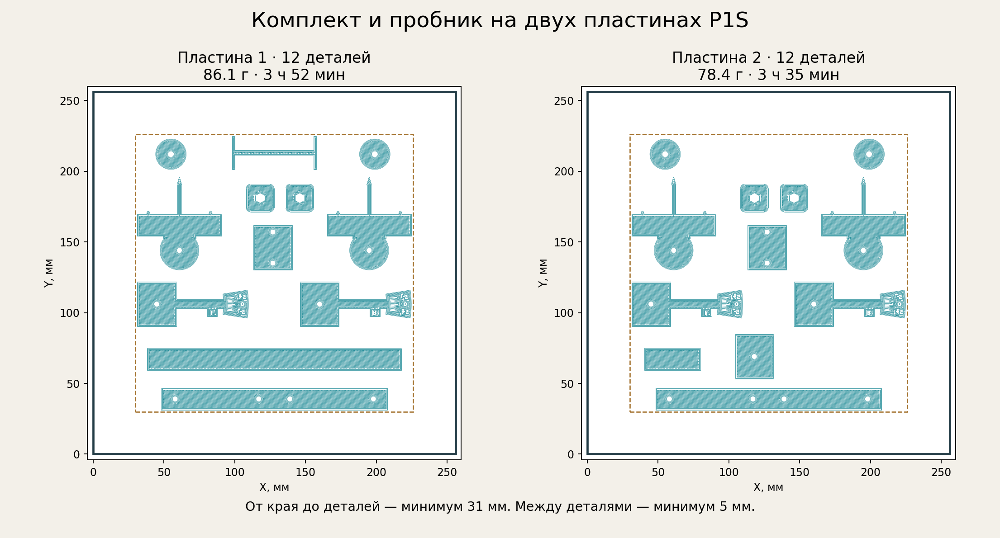
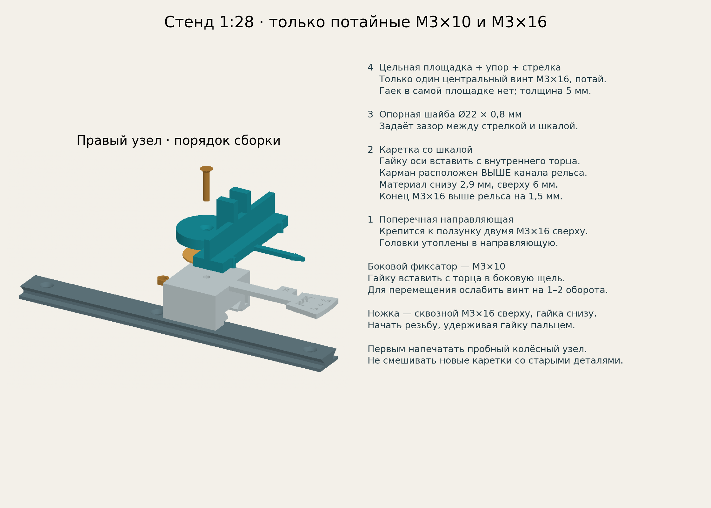
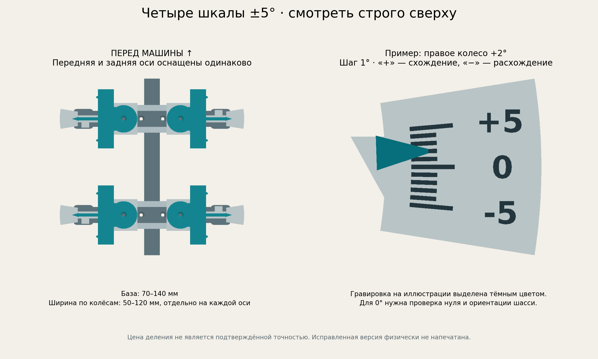

# Стенд схождения 1:28 — крепления под потайные М3×10 и М3×16

**Актуальная исправленная конструкция для четырёх колёс, остаётся масштаб 1:28.** Две поперечины перемещаются по продольной направляющей, четыре колёсных узла — по поперечинам. У каждого колеса собственная поворотная площадка, упор и шкала −5…+5° с шагом 1°. Сплошной базовой плиты нет.



## Что исправлено после пробной печати

- **Ось поворота:** потайной М3×16. Гайка загружается с внутреннего торца каретки в горизонтальный карман, расположенный выше канала направляющей. Она удерживается пластиком с обеих сторон по оси винта. Под карманом 2,9 мм пластика, над ним 6 мм. Номинальный конец винта на **1,5 мм выше рельса**, на 1,2 мм выше потолка его канала.
- **Поворотная деталь:** площадка, боковой упор, измерительные носики и стрелка объединены в `wheel_unit.stl`. Основание толщиной 5 мм, крепёжных гаек в нём нет. Вместо восьми винтов крепления упоров остаются только четыре осевых винта.
- **Ножки:** М3×16 проходит сверху через поперечину и ножку к **гайке снизу**. Гайка упирается в уступ толщиной 7,4 мм. Номинальный конец винта утоплен на 0,7 мм относительно стола. Отверстие сквозное, доступ к гайке открыт снизу.
- **Крепление поперечины:** два потайных М3×16, гайки в боковых пазах ползунка. Винты проходят по бокам продольной направляющей. Головки утоплены в поперечину и не мешают проходу колёсной каретки.
- **Зажим ползунка:** боковой М3×10 с потайной головкой и гайкой, загружаемой с торца. Стенки удерживают гайку по оси винта; его конец при затяжке прижимается к направляющей. Перед перемещением винт ослабить на 1–2 оборота. В рабочем положении головка этого зажимного винта может немного выступать сбоку — она не должна упираться в потай раньше, чем конец коснётся рельса.



Все указанные зазоры — расчётные для номинальных метизов. Предыдущая версия была напечатана пользователем и выявила дефекты; **эта исправленная версия физически ещё не напечатана**.

## Файлы и первая проба

**Сначала [P1S_mechanical_trial.3mf](P1S_mechanical_trial.3mf)** — небольшой комплект для проверки именно креплений. Семь деталей: `fit_rail`, `fit_slider`, один цельный колёсный узел, шайба, поперечина, ползунок поперечины и ножка. Проект повторно загружен и нарезан. Оценка: **42,67 г и 2 ч 02 мин**; [отчёт проверки](trial_validation.json).

Порядок проверки пробного комплекта:

1. Вставить гайку оси в верхний боковой паз `fit_slider`; совместить её отверстие с центральным отверстием каретки. Положить шайбу и `wheel_unit`, завернуть М3×16 сверху. Убрать осевой люфт, сохранив лёгкое вращение.
2. Надеть этот узел на `fit_rail`. Осевой винт не должен задевать направляющую при перемещении или повороте. Проверить боковой зажим с М3×10 и ещё одной гайкой: свободный ход после ослабления, фиксация при лёгкой затяжке.
3. Перенести пробную направляющую в ползунок поперечины. Вставить две гайки в его боковые пазы и прикрутить поперечину двумя М3×16 через внутренние отверстия. Проверить перемещение по пробной продольной направляющей.
4. Прикрутить ножку через крайнее отверстие поперечины одним М3×16. Перевернуть узел, вложить гайку снизу и удерживать пальцем до захвата первых витков. При затяжке гайка должна прижиматься к внутреннему уступу. Ножка должна стоять пластиком на столе; металл не должен выступать снизу.
5. Надеть колёсный пробный узел на поперечину и проверить проход над креплением поперечины, без затянутого бокового фиксатора. Проверить, что колесо вращает площадку без заметного заедания и качания.

Для этой проверки достаточно **4 винтов М3×16, 2 винтов М3×10 и 6 гаек М3**. Если гайка не входит рукой, сначала убрать заусенцы у входа; не забивать её и не затягивать силой. При необходимости изменить зазоры в параметрах и заново сформировать модели и нарезку.

После проверки — **[P1S_toe_M3x10_M3x16.3mf](P1S_toe_M3x10_M3x16.3mf)**, полный комплект на двух пластинах. По 12 деталей на каждой, минимум 31 мм от края и 5,43 мм между деталями. Две детали пробника включены во вторую пластину. Детали из пробной печати повторно печатать не нужно: исключить соответствующие экземпляры из полного проекта.

| Пластина полного проекта | Детали | Пластик, оценка | Время, оценка |
|---|---:|---:|---:|
| 1 | 12 | 86,08 г | 3 ч 52 мин |
| 2 | 12 | 78,44 г | 3 ч 35 мин |
| Всего, с пробником | 24 | **164,52 г** | **7 ч 27 мин** |



Основной и пробный 3MF — **проекты с геометрией и настройками**, не готовые файлы задания принтеру. `checked_2plates.gcode.3mf` и `trial_checked.gcode.3mf` — отдельные проверочные файлы с нарезкой. Ничего на принтер не отправлялось. Все файлы находятся непосредственно в единственной папке `toe_stand_128`, без подпапок и архивов старых версий.

## Печать

Принтер **Bambu Lab P1S**. **Сопло 0,4 мм, Generic PLA и Textured PEI Plate — допущения, материал и сопло пользователем не подтверждены.** Настройки: слой 0,20 мм, 4 периметра, 5 верхних и 5 нижних слоёв, 20% Gyroid, без поддержек и каймы. Небольшие сечения могут целиком состоять из стенок и сплошного заполнения.

STL уже ориентированы для печати, нижняя поверхность на Z=0. Каретки, ползунки поперечин и пробный ползунок печатаются перевёрнутыми, каналом направляющей вверх. Гравировка шкал обращена к столу. Не применять автоматическую переориентацию проекта. Цельные колёсные узлы печатаются площадкой вниз, контактами вверх.

Крыши боковых пазов гаек и нижние карманы ножек содержат короткие мосты шириной примерно 6–7 мм. При осмотре пробы проверить, что мосты не провисли внутрь посадочных мест. Сами несущие уступы имеют толщину в несколько миллиметров, тонких мембран для удержания гайки здесь нет.

Для сохранения рисок шкал выбран `classic`, включено обнаружение тонких стенок, ширина линии первого слоя 0,42 мм, компенсация «слоновьей ноги» отключена. Наплывы первого слоя убрать до проверки подвижных соединений. Для улучшения видимости шкал допускается подкрасить углубления маркером.

## Комплект и крепёж

| STL | Количество в стенде |
|---|---:|
| `spine.stl` — продольная направляющая | 1 |
| `crossrail.stl` — поперечина с потайными отверстиями | 2 |
| `axle_saddle.stl` — ползунок поперечины | 2 |
| `wheel_carriage_left.stl` — левая каретка L | 2 |
| `wheel_carriage_right.stl` — правая каретка R | 2 |
| `wheel_unit.stl` — цельная площадка с упором и стрелкой | 4 |
| `bearing_washer.stl` — шайба Ø22 × 0,8 мм | 4 |
| `foot.stl` — сквозная ножка | 4 |
| `zero_block.stl` — блок проверки нуля | 1 |

Всего **22 детали стенда**, отдельно `fit_rail.stl` и `fit_slider.stl` — пробник. 11 уникальных STL.

| Метиз | Количество | Назначение |
|---|---:|---|
| **М3×16, потай** | **12** | 4 оси поворота, 4 крепления поперечин, 4 ножки |
| **М3×10, потай** | **6** | Боковые зажимы четырёх кареток и двух ползунков |
| Обычная гайка М3 | **18** | Все соединения |

Длина потайного винта измеряется **вместе с головкой**. В расчёте: головка Ø6 мм, угол 90°, гайка под ключ 5,5 мм и высотой 2,4 мм; посадочный потай Ø6,6 мм. Размеры фактических метизов проверить на пробе. Высокие самоконтрящиеся гайки в эти карманы не рассчитаны.

## Сборка полного стенда



1. Вставить гайки боковых зажимов с торцов двух ползунков поперечин, завести М3×10 на несколько витков и надеть ползунки на продольную направляющую.
2. Вставить по две гайки в нижние горизонтальные пазы этих ползунков с торца. Совместить отверстия гаек с отверстиями под винты. Прикрепить поперечины двумя М3×16 каждую через отверстия в ±11 мм от центра. Головки утопить, не деформируя пластик. Проверить перпендикулярность поперечин продольной направляющей.
3. В каждую колёсную каретку вставить гайку оси с внутреннего торца, в паз над каналом рельса. В другой торцевой паз вставить гайку бокового фиксатора и начать резьбу М3×10. Гайки в горизонтальных пазах удерживаются от осевого выдавливания; до установки винта они могут выскользнуть обратно через загрузочный вход при наклоне детали.
4. На каждую каретку положить шайбу и цельный колёсный узел, закрепить ось М3×16 сверху. Головка должна быть утоплена; убрать люфт без тугого вращения. **Сначала собрать и проверить ось, затем надеть каретку на рельс.** Это позволяет увидеть конец винта снизу и проверить его положение.
5. На каждую поперечину надеть по одному L и R. **L слева машины, R справа**, если смотреть вперёд по направлению движения. Шкалы и стрелки направлены наружу. Левый узел развёрнут на 180° относительно правого. Обе пары одинаковы спереди и сзади.
6. Установить четыре ножки под крайние отверстия поперечин. Пропустить М3×16 сверху насквозь; гайку вложить снизу и удерживать до захвата резьбы. При затяжке гайка притягивается к уступу внутри ножки. Поставить раму на ровную поверхность и убедиться, что металл не выступает из ножек. Продольная направляющая приподнята над столом на 1 мм.
7. Ослабить боковые М3×10 и проверить полный рабочий ход. Затем выставить базу и ширину и умеренно затянуть зажимы. Оси поворота при регулировке углов остаются свободными; зажимать их для удержания колеса не нужно.

Старые **продольную направляющую, блок нуля и простой отрезок пробной направляющей** можно сохранить, если они напечатаны без дефектов. Поперечины, ножки, оба ползунка, четыре каретки, четыре колёсных узла и шайбы нужны новые. Старые раздельные площадки и упоры не использовать в этой сборке. Старые поперечины имеют другую форму углублений под головки; новый проект предусматривает перепечатку.

## Диапазоны и измерение

| Параметр | Значение |
|---|---|
| Колёсная база | 70–140 мм |
| Ширина по наружным боковинам | 50–120 мм, независимо на каждой оси |
| Диаметр / ширина шины | Проектно 20–40 / 6–14 мм |
| Высота опоры колёс над столом | 34,8 мм |
| Направляющие | Продольная 180 × 16 × 6 мм; поперечные 160 × 16 × 6 мм |
| Шкала каждого колеса | −5…+5°, шаг 1° |
| Радиус начала рисок / конца стрелки | 50 / 52 мм |
| Зазор стрелки над шкалой | 0,8 мм |
| Упоры | Длина 60 мм, расстояние между контактами 12 мм |
| База измерительных носиков | 44 мм |



**Цена деления не означает подтверждённую точность.** Печатные зазоры, поворот каретки на направляющей, деформация шины и положение шасси влияют на отсчёт. Совместимость с конкретной моделью определяется размерами, а не только обозначением 1:28.

Для нуля назначить перед рамы, проверить прямолинейность продольной направляющей и перпендикулярность поперечин. Поставить блок нуля на две площадки проверяемой оси. Подвести оба контакта каждого упора к параллельным наружным граням блока. **Независимо выставить блок параллельно продольной направляющей** угольником и прямой линейкой: сам зажим упорами не задаёт абсолютного нуля. Печатный блок не является поверенным эталоном.

Записать отсчёт `α₀` отдельно для FL, FR, RL, RR. Повторить после переустановки и после разворота блока на 180°. При нестабильности устранить заедание, люфт или перекос. Упор теперь цельный с площадкой и отдельно не переставляется. Рабочий угол: **`α = отсчёт шкалы − α₀`**. После изменения базы, ширины или затяжки проверить ноль снова.

Установить машину с рабочим аккумулятором, усадить подвеску, выставить развал и рулевую нейтраль. Продольную ось самого шасси совместить с направляющей по двум разнесённым парам симметричных точек шасси. Одинаковая ширина между колёсами сама по себе этого не подтверждает. При необходимости снять кузов.

Подвести все четыре узла, совместив середину упора с осью колеса. Контакты должны касаться одинаковых участков боковины без давления. Закрепить линейные ползунки. Регулировать штатные тяги машины, позволяя площадкам свободно поворачиваться; если на конкретной оси нет штатной регулировки схождения, стенд позволяет его измерить. Считать шкалы строго сверху и вычитать индивидуальные поправки нуля. **«+» — схождение, «−» — расхождение** при правильной установке L/R. Например, +1° на каждом колесе оси означает +2° суммарно.

После регулировки проверить обе оси повторно. Для проверки повторяемости снять машину, прокатить на столе и снова поставить; при биении шин повторить с колёсами, повёрнутыми на 180°. Не давить на упоры и не прокатывать машину далеко по маленьким площадкам.

Дополнительный контроль штангенциркулем: измерить расстояния `F` между передними носиками и `R` между задними. Сначала определить на параллельном блоке `Δ₀ = R₀ − F₀`. Для базы 44 мм `Δ = R − F − Δ₀`, суммарный малый угол ≈ `1,3022 × Δ[мм]` градусов. При идеальной симметрии точная формула `2 × asin(Δ / 88)` с переводом в градусы. Этот метод не определяет отдельный угол колеса. Носики теперь расположены на высоте основания; проверить доступ губок штангенциркуля.

```sh
python3 toe_angle.py --front 110 --rear 111.5 --zero-delta 0.1
```

## Что проверено

- 11 STL после повторного чтения: замкнутость, согласованные нормали, положительный объём, одна связная оболочка, отсутствие вырожденных граней, Z=0.
- 34 положения сборки, включая крайние базы, ширины и независимые повороты обеих осей ±5°: недопустимых пересечений печатных деталей нет.
- **109 проверок крепежа и путей вставки гаек**, материал удержания гаек в обоих осевых направлениях, подход отвёртки. **131 положение каретки** на поперечине с установленными винтами, гайками и ножками. Номинальные траектории свободны при ослабленном боковом зажиме. [Отчёт по крепежу](hardware_validation.json).
- Полный и пробный проекты **повторно загружены и нарезаны именно из выдаваемых 3MF** в Bambu Studio 02.08.02.61. Проверены ZIP, геометрия, экземпляры `build`, привязки `model_instance`, настройки P1S/PLA/0,4 мм и реальные габариты. Код процессов и `return_code` равны 0; списки пластин и G-code непустые; `warning_message` пусты; `[error]` в итоговых журналах нет.
- В полном G-code проверены **44 канавки шкал**, а также **105 сечений каналов гаек и отверстий под винты** на разных высотах. Они не закрыты заполнением. Поддержки отключены и отсутствуют в G-code. [Каналы крепежа](fastener_toolpath_validation.json), [визуализация](fastener_toolpaths.png).

В журналах есть служебные предупреждения CLI о `machine_full/process_full`, цветах, списке сопел и типе древовидных поддержек. Профили полностью разрешены, сохранённые значения проверены; поддержек в фактических траекториях нет. Параметр `detect_floating_vertical_shell: "0"` сохранён для совместимости с установленной версией.

[Геометрия и сборка](geometry_validation.json) · [Полный проект](validation.json) · [Пробный проект](trial_validation.json) · [Пластина 1](plate_1_verification.json) · [Пластина 2](plate_2_verification.json) · [Шкалы в нарезке](scale_toolpaths.png).

**Физическая посадка исправленных деталей, качество мостов, прочность под нагрузкой и точность измерений ещё не подтверждены. Первая печать — механическая проба.**

## Редактирование и пересборка

Параметры: [parameters.json](parameters.json). Параметрическая геометрия: [build.py](build.py). Все размеры в миллиметрах. Проверки метизов используют [hardware_geometry.py](hardware_geometry.py) и [verify_hardware.py](verify_hardware.py).

Из корня проекта:

```sh
.venv/bin/python -B toe_stand_128/build.py
.venv/bin/python -B toe_stand_128/verify_hardware.py
.venv/bin/python -B toe_stand_128/prepare_two_plates.py
.venv/bin/python -B toe_stand_128/inspect_two_plates.py
.venv/bin/python -B toe_stand_128/inspect_fastener_paths.py
.venv/bin/python -B toe_stand_128/prepare_trial.py
.venv/bin/python -B toe_stand_128/assembly_guide.py
```

После изменения геометрии или параметров заново подготовить проекты и нарезку. Предыдущие отчёты к изменённой геометрии не относятся. При изменении конструктивных размеров обновить проверки крепежа, разрезы и раскладки.
